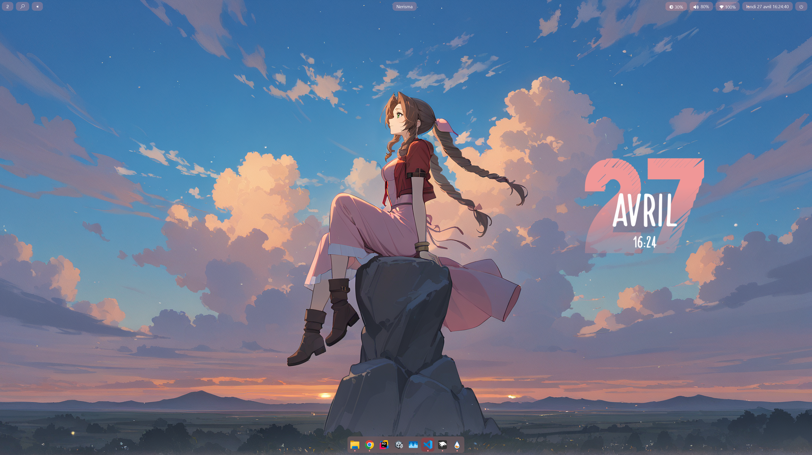

# Nericema



## Quick Download

You can download only the parts you want without cloning the whole repository.

- Open the folder you want on GitHub.
- Download only the files you need, or grab that specific folder as a ZIP.
- Drop them into your local config location.

## Tools Used

- YASB: `%USERPROFILE%\.config\yasb\config.yaml` and `%USERPROFILE%\.config\yasb\styles.css`
- Rainmeter: `%USERPROFILE%\Documents\Rainmeter\Skins\Nericema\clock.ini`
- GlazeWM: `%USERPROFILE%\.glzr\glazewm\config.yaml`
- AutoHotkey: `%USERPROFILE%\Documents\AutoHotkey\rapidkeys.ahk`
- Windhawk: manual setup (TaskbarStyler > DockLike, Taskbar Icons Height mods), no script provided

## Optional GlazeWM Widget In YASB

If you do not use GlazeWM, you can remove the GlazeWM widget from [yasb/config.yaml](yasb/config.yaml).
The rest of the YASB configuration can still be used without it.

## Setup Script

[setup.ps1](setup.ps1) creates symbolic links from this repository to the default config locations for each tool.
It prompts you tool by tool so you can choose exactly what to link, and it automatically restarts with administrator rights, which are required here for symbolic link creation.

If script execution is disabled on your system, launch it with:

```powershell
powershell -NoProfile -ExecutionPolicy Bypass -File .\setup.ps1
```

Currently supported in the script:

- GlazeWM
- YASB
- Rainmeter
- AutoHotkey

Windhawk is intentionally excluded.
